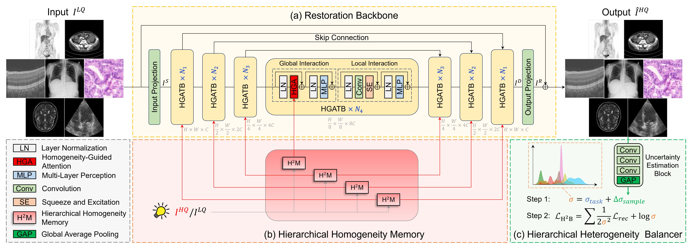
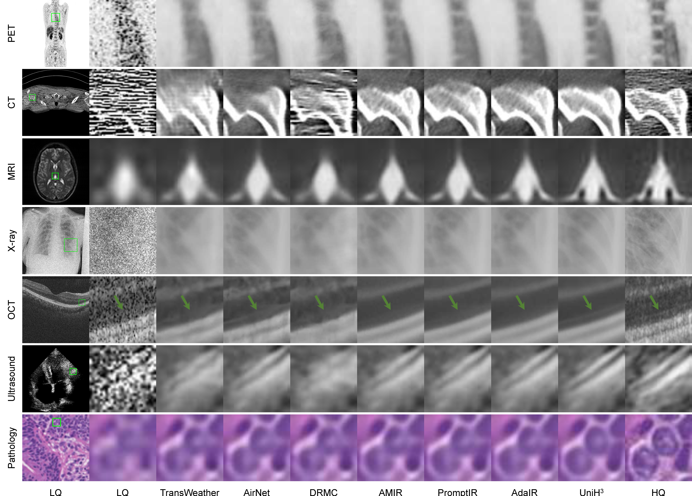

# UniH<sup>3</sup>: Unifying Hierarchical Homogeneity and Heterogeneity for All-in-One Medical Image Restoration

PyTorch implementation for UniH<sup>3</sup>: Unifying Hierarchical Homogeneity and Heterogeneity for All-in-One Medical Image Restoration[](https://arxiv.org/abs/2609.11156)

:rocket::rocket::rocket:Check our paper collection of recent **Awsome-Medical-Image-Restoration** [](https://github.com/Yaziwel/Awesome-Medical-Image-Restoration)

## Network Architecture



## Visualization



## Dataset

| 数据集            | 模态                                            | 链接                                                         |
| ----------------- | ----------------------------------------------- | ------------------------------------------------------------ |
| **MedIR-2D-500K** | PET, CT, MRI, X-ray, OCT, Ultrasound, Pathology | [ Hugging Face - MedIR-2D-500K](https://huggingface.co/datasets/upyzwup/MedIR-2D-500K) |
| **MedIR-3D-3K**   | PET, CT, MRI                                    | [ Hugging Face - MedIR-3D-3K](https://huggingface.co/datasets/upyzwup/MedIR-3D-3K) |

## Citation

If you find UniH<sup>3</sup> useful in your research, please consider citing:

```bibtex
@inproceedings{yang2026unih3,
  title={UniH$^3$: Unifying Hierarchical Homogeneity and Heterogeneity for All-in-One Medical Image Restoration},
  author={Yang, Zhiwen and Li, Jiayin and Liu, Chengyu and Zhang, Hui and Wei, Bingzheng and Xu, Yan},
  booktitle={European Conference on Computer Vision},
  pages={395--413},
  year={2026},
  organization={Springer}
}
```
